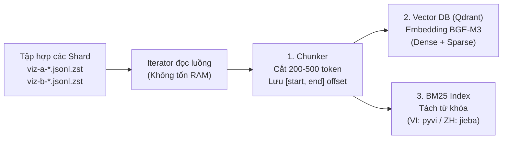

> Sau khi crawl hết, ta ghép data lại vs nhau như thế nào?

Quá trình "ghép lại với nhau" trong dự án này được hiểu theo 2 cấp độ:
- Cấp độ tệp tin (File Management): Gom các file shard tải từ Kaggle (hoặc từ Member A) về kho dữ liệu chung.
- Cấp độ pipeline (Data Ingestion): Cách hệ thống đọc toàn bộ các shard này để đưa vào cơ sở tri thức (Vector DB + BM25) phục vụ truy hồi.

Dưới đây là hướng dẫn chi tiết từng bước:
## CẤP ĐỘ 1: Gom các file Shard tải về từ Kaggle / Member A
Khi bạn chạy nhiều Notebook trên Kaggle và tải các file zip về máy, bạn sẽ có nhiều file shard lẻ như:

viz-b-120ask_com-00001.jsonl.zst
viz-b-120ask_com-00002.jsonl.zst
viz-b-familydoctor_com_cn-00001.jsonl.zst

Các shard của 51 domain nhỏ: viz-b-00001.jsonl.zst...

⚠️ Quy tắc sống còn: KHÔNG GỘP THÀNH 1 FILE KHỔNG LỒ!

Sai lầm phổ biến: Cố giải nén ra rồi nối toàn bộ 4.39 triệu dòng vào 1 file duy nhất (file sẽ nặng hơn 30GB–50GB, gây tràn RAM và crash mọi tiến trình đọc sau này).

Quy ước bắt buộc của dự án (Mục 1 & 7): Giữ nguyên từng file Shard độc lập (mỗi file 20.000 – 50.000 tài liệu, nén zstd chỉ nặng ~50MB – 150MB).

Cách tổ chức vào thư mục chung của dự án:

Bạn giải nén và xếp các file vào đúng vị trí quy định, cho cả 3 folder docs/, manifest/, logs/ tương ứng 
```
corpus/
├── viz/
│   ├── docs/
│   │   ├── a/                     <- Toàn bộ shard của Member A gửi sang
│   │   │   ├── viz-a-00001.jsonl.zst
│   │   │   └── viz-a-00002.jsonl.zst
│   │   └── b/                     <- Toàn bộ shard của Member B (từ Kaggle về)
│   │       ├── viz-b-00001.jsonl.zst
│   │       ├── viz-b-00002.jsonl.zst
│   │       └── ...
│   └── manifest/
│       ├── a/ (các file manifest .json tương ứng)
│       └── b/
```
# CẤP ĐỘ 2: Đóng băng dữ liệu (Tạo Manifest gộp final/v1/shards.json)
Theo Mục 7 trong Kế hoạch thu thập, việc "gộp corpus" thực chất là tạo ra một file danh mục quản lý (manifest manifest registry) chứa danh sách toàn bộ các shard hợp lệ và mã băm SHA-256 để nghiệm thu.
Tham khảo file script: `scripts/build_final_manifest.py`

## CẤP ĐỘ 3: Pipeline phía sau sẽ "ghép" và tiêu thụ các Shard này như thế nào?
Sau khi có danh mục final/v1/shards.json, các module tiếp theo trong dự án sẽ đọc và xử lý song song (Streaming Processing) theo sơ đồ:


- **Bước 1 - Chunker (src/preprocess/chunk.py):** Hàm đọc mở từng file .jsonl.zst theo dạng stream (đọc dòng nào xử lý dòng đó, không đọc hết cả file). Cắt bài viết thành các đoạn 200–500 token, lưu chính xác start và end offset trên chuỗi văn bản gốc.
- **Bước 2 - Lập chỉ mục song song (src/index/):** Đoạn văn được đưa qua BGE-M3 để tạo vector đặc trưng và nạp vào Qdrant Vector Database.
Đồng thời được tách từ để nạp vào chỉ mục từ khóa BM25.
- **Bước 3 - Truy hồi và Hợp nhất (RRF Fusion):** Khi có câu hỏi y khoa tiếng Việt từ đề thi, hệ thống bắn truy vấn vào cả Qdrant và BM25. Thuật toán RRF (Reciprocal Rank Fusion) sẽ tự động "ghép" và hòa trộn bảng xếp hạng kết quả từ tất cả các nguồn (VI, ZH và PubMed EN) để chọn ra những tài liệu và đoạn trích có điểm liên quan cao nhất!